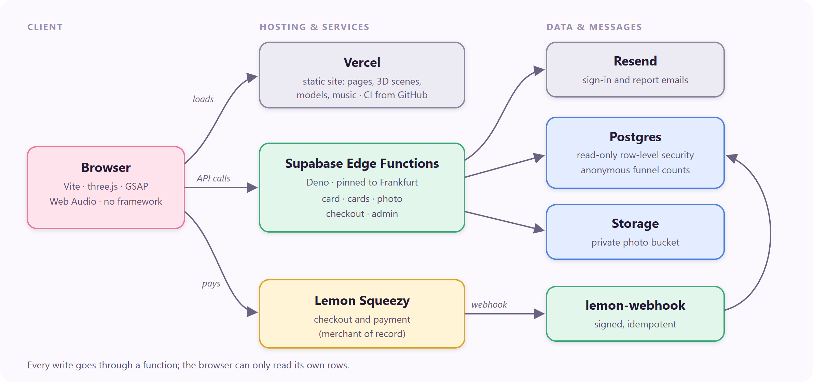

# Heartgift

**Animated 3D greeting cards in the browser. Live at [heartgift.app](https://heartgift.app).**

Pick a design, write a name and a message, choose the music and share a short link. The person who opens it gets a short
3D film made for them: no app, no account, on a phone or a computer.


The source code is private. This page describes how it is built.

## What it is

- **19 designs** for birthdays, anniversaries, graduations and holidays. Nine are short scenes and ten are Deluxe films with their own music.
- **Three plans:** Free, Premium ($4: choose the instrument and tempo, longer life) and Deluxe ($6: the films, and an optional photo of the sender).
- A solo project that covers everything from the 3D scenes and music to payments, moderation and the legal pages.

## Architecture



| Layer | Technology |
|---|---|
| Front end | JavaScript without a framework, Vite, three.js, GSAP, Web Audio |
| Back end | Supabase: Postgres, Auth, Storage, 6 Edge Functions (Deno) |
| Payments | Lemon Squeezy (merchant of record), signed webhooks |
| Hosting | Vercel, deployed on every push to `master`; GitHub Actions runs the tests and the build |
| Tests | Node's test runner; server tests on real Postgres in memory (PGlite) |

## Technical points

### Graphics and performance
- **Everything is drawn in code.** Almost every scene, character, effect and melody is generated by code written for this project. The exceptions are two character models, a few pine trees and street lamps, and one music recording, all under open licences and credited on the site.
- **A quality governor.** Each device starts in one of three tiers (high, medium, low). While the card plays, detail is dropped one step at a time (edge smoothing, resolution, shadows, bloom) whenever the median frame rate stays below 38 fps. It uses the median, not the average, so the slow frames of shaders compiling do not cost a fast phone its sharpness. It has unit tests.
- **No stutter at the start.** Before the Open button appears, the whole scene is drawn once off screen. This compiles every shader and uploads every texture before the film begins.
- **Small downloads.** A person opening a card downloads 9.8 KB of compressed start-up script (it was 99 KB before the editor and the sign-in library were split out), plus the 3D engine and the one scene the card uses.
- **Battery.** Once the film is over the card is drawn at about 30 frames a second, and at full speed again while the viewer turns it. The sound pauses with a hidden tab, so it stays in step with the picture.
- **It always delivers the message.** If the device has no WebGL, loses its graphics memory, or the network stalls for 30 seconds, the card is shown as a plain page with the same words.
- **Phone checks.** A script plays every design as an Android phone (turned mid-film, address bar moving, full screen) and fails if the camera path changes.

### Data and back end
- **Writes only through functions.** Row-level security lets a browser read only its own rows; every write goes through an Edge Function that checks the rules again.
- **One set of rules on both sides.** The plan and price rules live in shared files that the browser and the server both import. A sync script copies them to the server, and the tests fail if the copy is out of date.
- **No double free cards.** A trigger takes an advisory lock, so two cards created at the same moment cannot both use the last free slot.
- **An idempotent payment webhook.** It verifies the signature, remembers each event so a repeat is skipped, and forgets it again on failure so the provider's retry is handled. If our order row was lost, it rebuilds the order from the signed checkout data. If the amount does not match, it grants nothing and emails the owner.
- **Region pinning.** The functions are pinned to the database's region (Frankfurt). Left alone, a visitor in Vietnam was served from Seoul and every call crossed half the world to reach the database.
- **Photo moderation.** A sender's photo is checked on the server, kept in a private bucket and shown only through short-lived signed links. Anyone with the link can report it, which hides it at once. The reporter can undo within a minute, and the owner reviews reports on an admin page.

### Analytics without tracking people
- **Visit statistics** (Vercel Web Analytics, no cookies) drop the card code, the names and the message from every address before it is sent.
- **An anonymous conversion funnel.** A table holds only counts per day, design and plan (created, checkout opened, paid, first opened). Nothing in it can be joined back to a card or a person. It answers which designs people finish and pay for, and where they stop.

```sql
select template,
       sum(n) filter (where event in ('created', 'guest_created')) as made,
       sum(n) filter (where event = 'checkout') as checkouts,
       sum(n) filter (where event = 'paid') as paid,
       round(100.0 * sum(n) filter (where event = 'paid')
             / nullif(sum(n) filter (where event = 'checkout'), 0), 1) as pay_rate_pct
from public.event_counts
where day >= current_date - 30
group by template
order by made desc nulls last;
```

### Security
- A content security policy (scripts only from the site itself, the one inline script allowed by its hash), together with `Referrer-Policy`, `X-Content-Type-Options` and `Permissions-Policy`. A test fails when an inline script changes without its hash.
- Every piece of text a sender types is placed on the page as text, never as HTML.

## Contact

Diep Thai Khang. Write through the contact page at [heartgift.app](https://heartgift.app).
